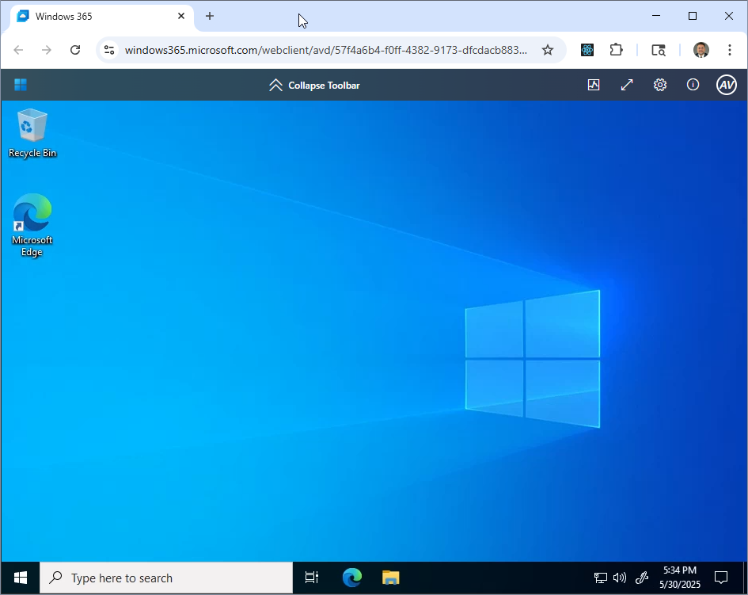
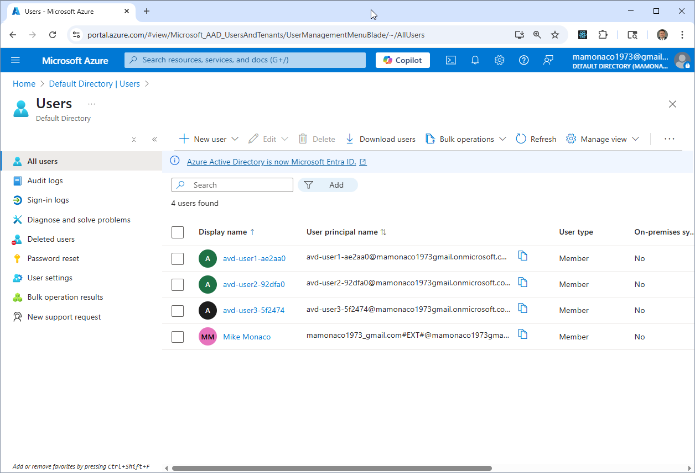
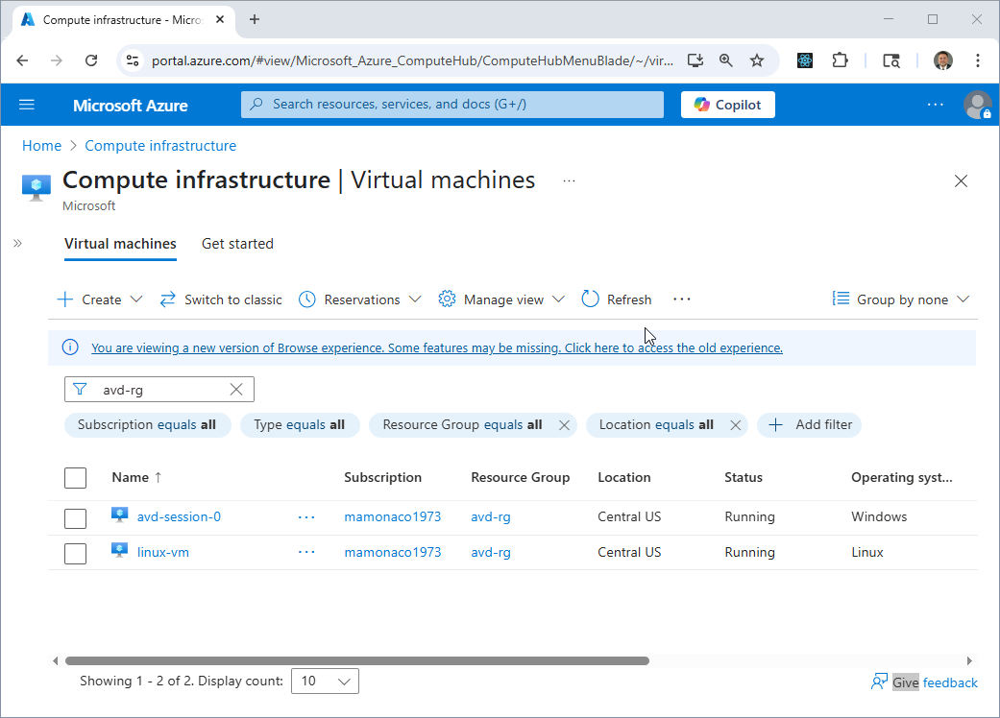
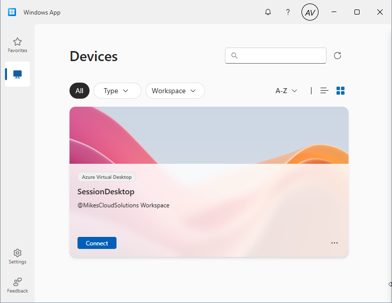

# Azure Virtual Desktop with Entra ID Join

The Azure companion to [Amazon WorkSpaces](https://github.com/mamonaco1973/aws-workspaces)
([video](https://youtu.be/rvz-GcEHlTY)). Terraform builds a cloud-only
**Azure Virtual Desktop** environment with no domain controllers and no
hybrid join: a pooled **host pool** of Windows Server 2022 session hosts
joined directly to **Entra ID**, a desktop **application group**, and a
**workspace**. It creates three Entra ID users with random names and
passwords in **Key Vault**, and a private Linux web server that the
desktop can reach, so AVD works like a lightweight VPN into the VNet.



| Piece | Where | Role |
|---|---|---|
| **avd-host-pool** | AVD, Central US | pooled, breadth-first load balancing, start VM on connect, desktop app group preferred; RDP properties for Entra ID sign-in (`enablerdsaadauth`, `targetisaadjoined`); registration token valid 700 hours |
| **avd-desktop-appgroup** | AVD | the `Desktop` application group; the three users get **Desktop Virtualization User** on it |
| **avd-workspace** | AVD | publishes the app group (friendly name `@MikesCloudSolutions Workspace`) |
| **Session host** `avd-<suffix>-0` | `vm-subnet` (`10.0.0.0/25`) | Windows Server 2022 Datacenter, `Standard_D2s_v3`, no public IP, system-assigned identity; `session_host_count` (default 1) of them |
| **Extensions** | each session host | `AADLoginForWindows` (Entra ID join), the AVD agent DSC (`AddSessionHost` with `aadJoin = true` and the registration token), then a reboot |
| **avd-user1..3-&lt;hex&gt;** | Entra ID | `@<default domain>`; **Virtual Machine User Login** on the resource group |
| **linux-vm** | `vm-subnet` | Ubuntu 24.04, `Standard_B1s`, no public IP; Apache from `custom_data.sh` |
| **creds-kv-&lt;suffix&gt;** | Key Vault | `user1..3-avd-credentials` and `vm-credentials` (`sysadmin`, shared by both VMs) |
| **vm-nat-gateway** | `vm-subnet` | outbound access; the subnet's default outbound access is off |
| **vm-nsg** | `vm-subnet` | SSH, RDP and HTTP in |
| **Bastion** (optional) | `AzureBastionSubnet` (`10.0.1.0/25`) | only when `bastion_support = true` (default `false`) |
| **avd-vnet** | `avd-rg` | `10.0.0.0/23` |

## Architecture

<picture>
  <source media="(prefers-color-scheme: dark)" srcset="architecture-dark.svg">
  
</picture>

Regenerate with `python3 make_diagram.py`. The optional Bastion host is
left off the diagram.

Everything is in **`01-avd/`**: `avd.tf` (host pool, token, app group,
workspace, session hosts and their extensions), `accounts.tf` (users and
role assignments), `linux_vm.tf`, `networking.tf`, `vault.tf` and
`bastion.tf`.

## What is Desktop as a Service?

**Desktop as a Service (DaaS)** delivers cloud-hosted desktops instead of
physical PCs or a self-run VDI stack. Users connect from a client or a
browser; IT manages identity, security and cost in one place. **Azure
Virtual Desktop** is Microsoft's DaaS, with Windows 10/11 and Windows
Server desktops that integrate with Entra ID and Microsoft 365. It
supports direct Entra ID join (no domain controllers), session-based load
balancing and autoscaling, pooled or personal desktops, and FSLogix
profiles on Azure Files.

Typical uses are secure remote work for staff and contractors, desktops
for training, development or regulated work, and less desktop patching
and provisioning.

## Prerequisites

* [An Azure Account](https://portal.azure.com/)
* [Install AZ CLI](https://learn.microsoft.com/en-us/cli/azure/install-azure-cli)
* [Install Terraform](https://developer.hashicorp.com/terraform/install)
* [Install jq](https://jqlang.github.io/jq/download/)
* The [Microsoft.AAD](https://learn.microsoft.com/en-us/azure/role-based-access-control/permissions/identity#microsoftaad) resource provider registered
* The identity that runs Terraform needs the **Global Administrator** Entra ID role (it creates users)
* [Windows App](https://apps.microsoft.com/detail/9n1f85v9t8bn?hl=en-US&gl=US) to connect, or the [web client](https://windows.cloud.microsoft/)

`check_env.sh` signs in with a service principal from `ARM_CLIENT_ID`,
`ARM_CLIENT_SECRET`, `ARM_SUBSCRIPTION_ID` and `ARM_TENANT_ID`. If this is
your first time watching our content, we recommend starting with this
video: [Azure + Terraform: Easy Setup](https://www.youtube.com/watch?v=wwi3kVgYNOk).

## Deploy

```bash
git clone https://github.com/mamonaco1973/azure-virtual-desktops.git
cd azure-virtual-desktops
./apply.sh
```

`apply.sh` runs `check_env.sh`, looks up the tenant's default domain with
Microsoft Graph, and applies `01-avd` with it:

```
NOTE: Default domain for account is <tenant>.onmicrosoft.com
```

The Entra ID users:



and the VMs, neither with a public IP:



## Try it

1. In Key Vault, open `user1-avd-credentials` (or `user2`, `user3`) and copy
   the username and password.
2. Open the Windows App (or the web client), sign in as that user, and set
   up MFA if prompted.

   

3. Open **SessionDesktop** and wait for the desktop to load.
4. In the portal, find `linux-vm`'s private IP, then open
   `http://<private-ip>` in Edge inside the session. You get Apache's
   default page, from a VM with no public IP.

## Teardown

```bash
./destroy.sh
```

`destroy.sh` looks up the default domain again and destroys `01-avd`,
including the Entra ID users.

## Notes

- **Lab only.** `vm-nsg` allows SSH, RDP and HTTP from any source (the VMs
  have no public IPs), both VMs share one `sysadmin` password, and Linux
  password sign-in is on.
- The registration token's expiry is computed from `timestamp()`, so every
  `terraform plan` shows it changing.
- `start_vm_on_connect` is on, but no role is granted to the AVD service to
  start VMs, so a stopped session host isn't started for you.
- `destroy.sh` doesn't run `check_env.sh`, so sign in first if your session
  has expired.
